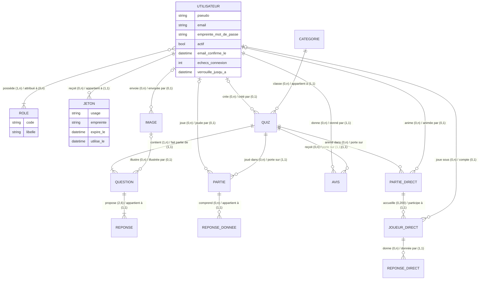
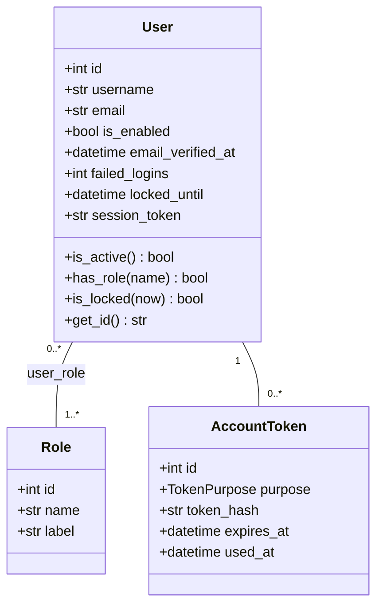
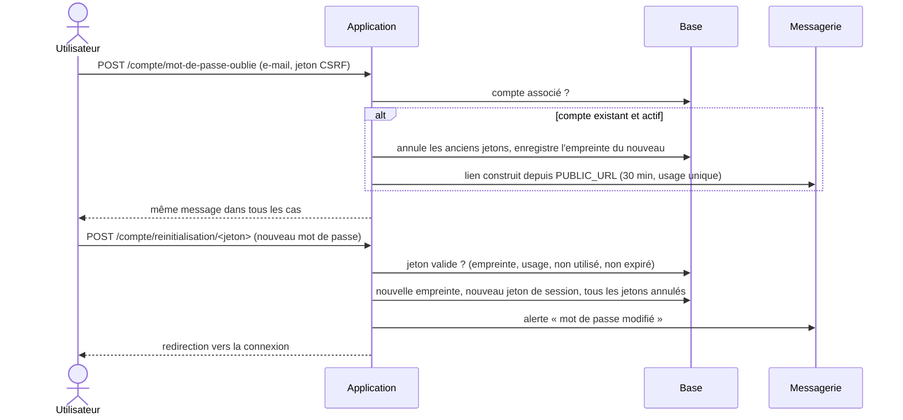
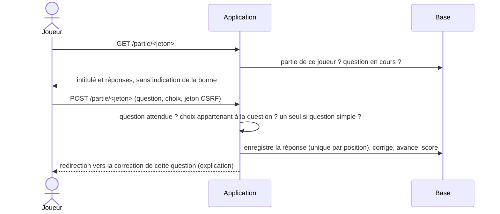
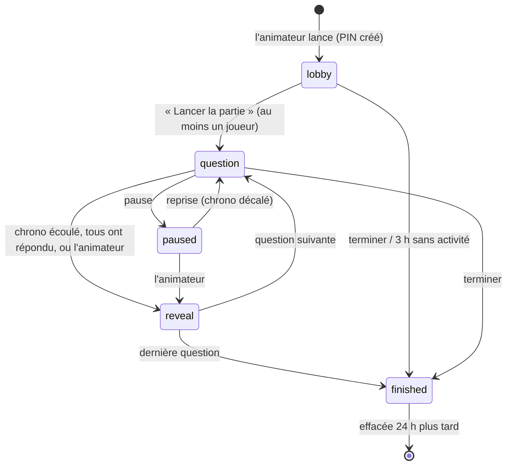

# Modèle de données — v2.0 (comptes, quiz, parties en direct)

La base n'a qu'**une source de vérité** : les modèles SQLAlchemy (`app/models/`) et les migrations
Alembic (`migrations/versions/`). Le fichier [`schema.sql`](schema.sql) est **généré** depuis les
migrations (`make schema`) ; l'intégration continue échoue s'il ne correspond plus.
Un test vérifie aussi que les migrations et les modèles décrivent exactement le même schéma.

## Règles de gestion

| N° | Règle |
|----|-------|
| RG01 | Un utilisateur est identifié par un pseudo unique (3 à 32 caractères `A-Z a-z 0-9 _ -`, unicité insensible à la casse) et une adresse e-mail unique, stockée en minuscules. |
| RG02 | Un utilisateur possède un ou plusieurs rôles parmi : joueur, créateur, administrateur. Un rôle peut être attribué à plusieurs utilisateurs. |
| RG03 | Toute inscription crée un compte avec le seul rôle joueur, inactif tant que l'adresse e-mail n'est pas confirmée. |
| RG04 | Un compte jamais activé est supprimé 30 jours après sa création. |
| RG05 | Le mot de passe compte de 12 à 128 caractères, ne figure pas dans la liste des mots de passe courants, ne contient ni le pseudo ni la partie locale de l'e-mail, et compte au moins 4 caractères différents. Seule son empreinte Argon2id est conservée. |
| RG06 | Après 5 échecs de connexion consécutifs, le compte est verrouillé 15 minutes ; le compteur repart à zéro à la connexion réussie ou à la réinitialisation. |
| RG07 | Un jeton (activation ou réinitialisation) appartient à un seul utilisateur, sert une seule fois, expire (24 h pour l'activation, 30 min pour la réinitialisation), et n'est conservé que sous forme d'empreinte SHA-256. |
| RG08 | Émettre un nouveau jeton annule les jetons du même usage encore valides ; changer de mot de passe annule tous les jetons de l'utilisateur. |
| RG09 | Changer de mot de passe renouvelle le jeton de session de l'utilisateur : toutes ses autres sessions sont fermées. |
| RG10 | Un compte désactivé par un administrateur ne peut plus se connecter et perd ses sessions ouvertes. |
| RG11 | Supprimer un compte supprime ses rôles, ses jetons et ses avis ; ses parties sont conservées de façon anonyme (utilisateur mis à NULL) ; ses quiz et images restent, sans auteur. |
| RG12 | Un quiz appartient à une seule catégorie et a un seul niveau (débutant, intermédiaire, avancé). Une catégorie référencée par un quiz ne peut pas être supprimée. |
| RG13 | Un quiz compte de 1 à 50 questions (au moins 3 pour être soumis) ; une question compte de 2 à 6 réponses, dont au moins une bonne, sans doublon ; chaque question a une explication. |
| RG14 | Cycle de vie d'un quiz : brouillon → en attente (soumis) → publié ou refusé (motif obligatoire, transmis au créateur). Un quiz publié modifié par son créateur repasse en attente ; un quiz refusé modifié repasse en brouillon. Seul un administrateur publie. |
| RG15 | Seuls les quiz publiés sont visibles et jouables par tous ; un brouillon n'est visible que de son créateur et des administrateurs. |
| RG16 | Une image est un PNG, JPEG ou WebP de 2 Mo et 4000 × 4000 pixels au plus, ré-encodée et renommée. Elle n'est servie qu'après une analyse antivirus favorable, et seulement si une question visible l'utilise. Un quiz ne peut être publié tant qu'une de ses images n'est pas analysée. Une image sans question depuis 24 h est supprimée. |
| RG17 | Une partie appartient à un joueur et à un quiz ; l'ordre des questions est figé au démarrage. Le joueur répond à la question en cours seulement, une seule fois ; le serveur corrige (une réponse est juste si l'ensemble des choix est exactement celui des bonnes réponses) et calcule le score. |
| RG18 | Un joueur a au plus une partie en cours par quiz (reprise automatique). Modifier les questions d'un quiz arrête ses parties en cours. |
| RG19 | Un joueur donne au plus un avis par quiz (note de 1 à 5, commentaire facultatif), après au moins une partie terminée ; il peut le modifier. |
| RG20 | Une partie en direct porte sur un quiz publié et est lancée par un créateur ou un administrateur (l'animateur). Son code PIN à 6 chiffres est unique parmi les parties en cours et libéré à la fin. |
| RG21 | Un joueur rejoint avec le PIN et un pseudo (1 à 20 caractères, mots grossiers refusés), unique dans la partie sans tenir compte de la casse, des accents ni des espaces ; un compte n'est pas nécessaire. Une partie compte au plus 200 joueurs. |
| RG22 | Une question en direct a un chrono de 10 à 60 s, mesuré par l'heure du serveur. Un joueur répond une seule fois, avant la fin du chrono, à la question en cours. La correction s'affiche à la fin du chrono, quand tous les joueurs ont répondu, ou sur décision de l'animateur. |
| RG23 | Une bonne réponse rapporte 500 points, plus jusqu'à 500 selon la rapidité (proportionnellement au temps restant) ; une mauvaise réponse ou une absence de réponse, 0. Une pause de l'animateur ne pénalise pas les joueurs. |
| RG24 | L'animateur peut mettre en pause, passer à la suite, exclure un joueur (retiré du classement), terminer. Une partie sans activité pendant 3 h est terminée automatiquement. |
| RG25 | À la fin, les joueurs connectés retrouvent la partie dans leur historique ; la partie, ses joueurs et leurs réponses sont effacés 24 h après la fin. |

## Dictionnaire des données

| Table | Colonne | Type | Contraintes | Description |
|-------|---------|------|-------------|-------------|
| user | id | entier | clé primaire | Identifiant |
| user | username | texte (32) | non nul, unique | Pseudo public |
| user | email | texte (254) | non nul, unique | Adresse e-mail (minuscules), privée |
| user | password_hash | texte (255) | non nul | Empreinte Argon2id du mot de passe |
| user | is_enabled | booléen | non nul | Faux si désactivé par un administrateur |
| user | email_verified_at | date-heure UTC | nul possible | Date de confirmation de l'e-mail |
| user | created_at / updated_at | date-heure UTC | non nul | Création, dernière modification |
| user | last_login_at | date-heure UTC | nul possible | Dernière connexion réussie |
| user | failed_logins | entier | non nul, ≥ 0 | Échecs de connexion consécutifs |
| user | locked_until | date-heure UTC | nul possible | Fin du verrouillage temporaire |
| user | session_token | texte (32) | non nul | Renouvelé à chaque changement de mot de passe |
| role | id | entier | clé primaire | Identifiant |
| role | name | texte (20) | non nul, unique | `player`, `creator`, `admin` |
| role | label | texte (50) | non nul | Libellé affiché |
| user_role | user_id, role_id | entiers | clé primaire composée, clés étrangères (cascade) | Attribution d'un rôle |
| account_token | id | entier | clé primaire | Identifiant |
| account_token | user_id | entier | non nul, clé étrangère (cascade), index | Titulaire |
| account_token | purpose | énumération | non nul | `activation` ou `reset` |
| account_token | token_hash | texte (64) | non nul, unique | Empreinte SHA-256 du jeton envoyé |
| account_token | created_at / expires_at | date-heure UTC | non nul | Émission, expiration |
| account_token | used_at | date-heure UTC | nul possible | Utilisation ou annulation |
| category | id, slug, name, description, position | entier, textes, entier | slug unique | Catégorie (données de référence) |
| quiz | id | entier | clé primaire | Identifiant |
| quiz | creator_id | entier | clé étrangère user (SET NULL), index | Créateur |
| quiz | category_id | entier | non nul, clé étrangère category (RESTRICT), index | Catégorie |
| quiz | title / description | texte (120 / 500) | titre non nul | Présentation |
| quiz | difficulty | énumération | `easy`, `medium`, `hard` | Niveau |
| quiz | status | énumération | `draft`, `pending`, `published`, `rejected`, index | Cycle de vie |
| quiz | rejection_reason | texte (500) | nul possible | Motif du dernier refus |
| quiz | created_at, updated_at, submitted_at, published_at | date-heure UTC | | Dates du cycle de vie |
| question | id, quiz_id, position | entiers | (quiz_id, position) unique, cascade | Ordre dans le quiz |
| question | text / explanation | texte (500) / texte long | non nuls | Intitulé, explication |
| question | media_id, media_alt | entier, texte (200) | SET NULL | Image et sa description |
| answer_option | id, question_id, position, text, is_correct | | (question_id, position) unique, cascade | Réponse proposée |
| media | id, uid, owner_id, mime_type, size, sha256 | | uid unique, index sha256 | Image stockée sous `<uid>.<ext>` |
| media | status, scan_detail, scanned_at | énumération `pending`/`clean`/`rejected` | index | Résultat de l'analyse |
| play_session | id, token, user_id, quiz_id | | token unique (43 car.), user SET NULL | Partie |
| play_session | question_ids | JSON | non nul | Ordre des questions, figé |
| play_session | current_index, score, total | entiers | ≥ 0 | Avancement et score (calculés par le serveur) |
| play_session | started_at, finished_at | date-heure UTC | | Début, fin |
| play_answer | id, session_id, position | | (session_id, position) unique | Réponse à une question |
| play_answer | question_id, selected_ids, is_correct, answered_at | entier, JSON, booléen | | Choix (JSON, jamais de repr Python) et correction |
| review | id, user_id, quiz_id, rating, comment, dates | | (user_id, quiz_id) unique, rating 1 à 5 | Avis |
| live_game | id, pin | entier, texte (6) | pin unique, NULL une fois terminée | Partie en direct |
| live_game | host_id, quiz_id | entiers | host SET NULL, quiz cascade | Animateur, quiz |
| live_game | status | énumération | `lobby`, `question`, `paused`, `reveal`, `finished` | Écran en cours |
| live_game | question_ids, current_index | JSON, entier | | Ordre figé, question en cours (-1 en salle d'attente) |
| live_game | time_limit, max_players | entiers | 10 à 60 s ; 2 à 200 | Réglages |
| live_game | question_started_at, question_deadline, paused_remaining_ms | dates UTC, entier | | Chrono (heure du serveur) |
| live_game | version | entier | | Incrémentée à chaque changement d'écran (mise à jour conditionnelle) |
| live_game | created_at, last_activity_at, ended_at | dates UTC | | Purge |
| live_player | id, game_id, user_id, nickname, nickname_key | | (game_id, nickname_key) unique ; user SET NULL | Joueur |
| live_player | token | texte (43) | unique | Secret gardé dans la session du joueur (reconnexion) |
| live_player | score, kicked, joined_at | | | Points cumulés, exclusion |
| live_answer | id, game_id, player_id, position, question_id | | (player_id, position) unique | Réponse en direct |
| live_answer | selected_ids, is_correct, points, elapsed_ms, answered_at | JSON, booléen, entiers | | Choix, correction, points, temps de réponse |

## Modèle conceptuel (MCD)

## Modèle logique (MLD)

- **role** (<u>id</u>, name, label)
- **user** (<u>id</u>, username, email, password_hash, is_enabled, email_verified_at, created_at,
  updated_at, last_login_at, failed_logins, locked_until, session_token)
- **user_role** (<u>#user_id</u>, <u>#role_id</u>)
- **account_token** (<u>id</u>, #user_id, purpose, token_hash, created_at, expires_at, used_at)
- **category** (<u>id</u>, slug, name, description, position)
- **quiz** (<u>id</u>, #creator_id, #category_id, title, description, difficulty, status,
  rejection_reason, created_at, updated_at, submitted_at, published_at)
- **media** (<u>id</u>, uid, #owner_id, mime_type, size, sha256, status, scan_detail, created_at, scanned_at)
- **question** (<u>id</u>, #quiz_id, position, text, explanation, #media_id, media_alt)
- **answer_option** (<u>id</u>, #question_id, position, text, is_correct)
- **play_session** (<u>id</u>, token, #user_id, #quiz_id, question_ids, current_index, score, total,
  started_at, finished_at)
- **play_answer** (<u>id</u>, #session_id, position, #question_id, selected_ids, is_correct, answered_at)
- **review** (<u>id</u>, #user_id, #quiz_id, rating, comment, created_at, updated_at)
- **live_game** (<u>id</u>, pin, #host_id, #quiz_id, status, question_ids, current_index, time_limit,
  max_players, question_started_at, question_deadline, paused_remaining_ms, version, created_at,
  last_activity_at, ended_at)
- **live_player** (<u>id</u>, #game_id, #user_id, nickname, nickname_key, token, score, kicked, joined_at)
- **live_answer** (<u>id</u>, #game_id, #player_id, position, #question_id, selected_ids, is_correct,
  points, elapsed_ms, answered_at)

## Diagramme de classes

## Séquence : réinitialisation du mot de passe

## Séquence : répondre à une question en solo

## États d'une partie en direct

