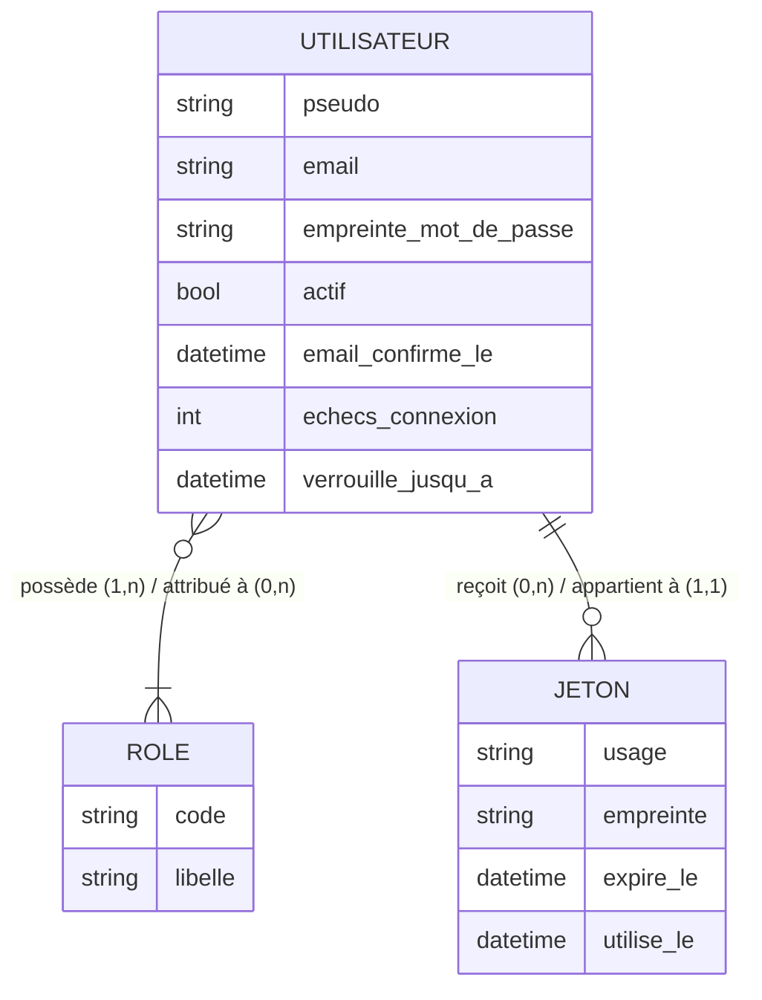
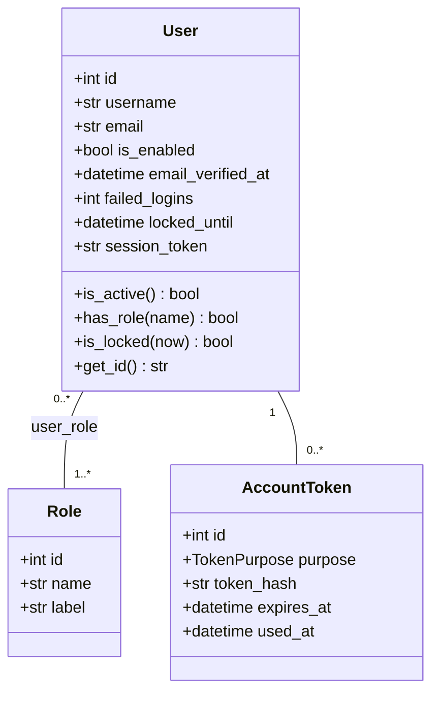
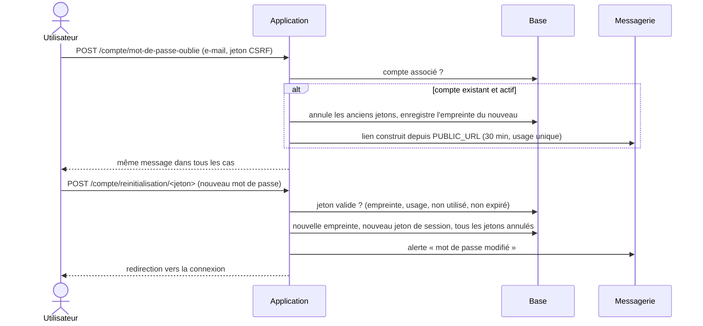

# Modèle de données — v1.0 (comptes)

La base n'a qu'**une source de vérité** : les modèles SQLAlchemy (`app/models/`) et les migrations
Alembic (`migrations/versions/`). Le fichier [`schema.sql`](schema.sql) est **généré** depuis les
migrations (`make schema`) ; l'intégration continue échoue s'il ne correspond plus.
Un test vérifie aussi que les migrations et les modèles décrivent exactement le même schéma.

## Règles de gestion

| N° | Règle |
|----|-------|
| RG01 | Un utilisateur est identifié par un pseudo unique (3 à 32 caractères `A-Z a-z 0-9 _ -`, unicité insensible à la casse) et une adresse e-mail unique, stockée en minuscules. |
| RG02 | Un utilisateur possède un ou plusieurs rôles parmi : joueur, créateur, administrateur. Un rôle peut être attribué à plusieurs utilisateurs. |
| RG03 | Toute inscription crée un compte avec le seul rôle joueur, inactif tant que l'adresse e-mail n'est pas confirmée. |
| RG04 | Un compte jamais activé est supprimé 30 jours après sa création. |
| RG05 | Le mot de passe compte de 12 à 128 caractères, ne figure pas dans la liste des mots de passe courants, ne contient ni le pseudo ni la partie locale de l'e-mail, et compte au moins 4 caractères différents. Seule son empreinte Argon2id est conservée. |
| RG06 | Après 5 échecs de connexion consécutifs, le compte est verrouillé 15 minutes ; le compteur repart à zéro à la connexion réussie ou à la réinitialisation. |
| RG07 | Un jeton (activation ou réinitialisation) appartient à un seul utilisateur, sert une seule fois, expire (24 h pour l'activation, 30 min pour la réinitialisation), et n'est conservé que sous forme d'empreinte SHA-256. |
| RG08 | Émettre un nouveau jeton annule les jetons du même usage encore valides ; changer de mot de passe annule tous les jetons de l'utilisateur. |
| RG09 | Changer de mot de passe renouvelle le jeton de session de l'utilisateur : toutes ses autres sessions sont fermées. |
| RG10 | Un compte désactivé par un administrateur ne peut plus se connecter et perd ses sessions ouvertes. |
| RG11 | Supprimer un compte supprime ses rôles et ses jetons (suppression en cascade). |

## Dictionnaire des données

| Table | Colonne | Type | Contraintes | Description |
|-------|---------|------|-------------|-------------|
| user | id | entier | clé primaire | Identifiant |
| user | username | texte (32) | non nul, unique | Pseudo public |
| user | email | texte (254) | non nul, unique | Adresse e-mail (minuscules), privée |
| user | password_hash | texte (255) | non nul | Empreinte Argon2id du mot de passe |
| user | is_enabled | booléen | non nul | Faux si désactivé par un administrateur |
| user | email_verified_at | date-heure UTC | nul possible | Date de confirmation de l'e-mail |
| user | created_at / updated_at | date-heure UTC | non nul | Création, dernière modification |
| user | last_login_at | date-heure UTC | nul possible | Dernière connexion réussie |
| user | failed_logins | entier | non nul, ≥ 0 | Échecs de connexion consécutifs |
| user | locked_until | date-heure UTC | nul possible | Fin du verrouillage temporaire |
| user | session_token | texte (32) | non nul | Renouvelé à chaque changement de mot de passe |
| role | id | entier | clé primaire | Identifiant |
| role | name | texte (20) | non nul, unique | `player`, `creator`, `admin` |
| role | label | texte (50) | non nul | Libellé affiché |
| user_role | user_id, role_id | entiers | clé primaire composée, clés étrangères (cascade) | Attribution d'un rôle |
| account_token | id | entier | clé primaire | Identifiant |
| account_token | user_id | entier | non nul, clé étrangère (cascade), index | Titulaire |
| account_token | purpose | énumération | non nul | `activation` ou `reset` |
| account_token | token_hash | texte (64) | non nul, unique | Empreinte SHA-256 du jeton envoyé |
| account_token | created_at / expires_at | date-heure UTC | non nul | Émission, expiration |
| account_token | used_at | date-heure UTC | nul possible | Utilisation ou annulation |

## Modèle conceptuel (MCD)

## Modèle logique (MLD)

- **role** (<u>id</u>, name, label)
- **user** (<u>id</u>, username, email, password_hash, is_enabled, email_verified_at, created_at,
  updated_at, last_login_at, failed_logins, locked_until, session_token)
- **user_role** (<u>#user_id</u>, <u>#role_id</u>)
- **account_token** (<u>id</u>, #user_id, purpose, token_hash, created_at, expires_at, used_at)

## Diagramme de classes

## Séquence : réinitialisation du mot de passe

